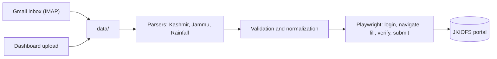

# JK Flood Automation

Automated hydrological data pipeline for the Jammu & Kashmir Integrated Operational Flood Forecasting System (JKIOFS). It collects flood-gauge and rainfall data from the formats it actually arrives in (WhatsApp text, PDF, Excel, images), validates it, and enters it into the JKIOFS web portal with browser automation, replacing manual data entry.

In production it updates nearly 50 gauge stations every hour, around the clock.

> **Access note:** JKIOFS is a Government of Jammu & Kashmir system. Running this tool requires authorized portal credentials.

## Features

- **Multi-format ingestion:** WhatsApp text, PDF, Excel (`.xls` / `.xlsx`), plain text, and images (read through the GLM-OCR API).
- **Three data streams:** Kashmir gauge readings, Jammu gauge readings, and regional rainfall.
- **Two intake paths:** files emailed to a Gmail inbox (IMAP) or uploaded through the web dashboard.
- **Browser automation:** Playwright logs in, navigates to the right region, date, and time slot, fills the fields, and submits.
- **Verification:** filled values are read back and compared with the parsed values, with retries, before submission.
- **Failure diagnostics:** daily log files and screenshots when verification or submission fails.
- **Web dashboard:** password-protected Flask UI with a file manager, a one-click **Run All Automations** button, and live run status and logs.

## How it works



The system is a three-layer pipeline:

1. **Ingestion:** `auto_fetcher.py` downloads attachments from the Gmail inbox over IMAP and routes them by type. The dashboard saves uploaded files to `data/`.
2. **Processing:** format-specific parsers produce a normalized data model. Station names, units, and times are normalized and checked.
3. **Submission:** the browser automation engine fills and verifies the portal fields, submits, and archives the processed files.

### Supported inputs

| Region | Input formats | Parser |
|---|---|---|
| Kashmir | WhatsApp text (`.txt` or email body) | `parser/kashmir_parser.py` |
| Jammu | PDF, Excel, plain text, images | `jammu/` (dispatcher plus per-format parsers) |
| Rainfall | Excel | `rainfall/rainfall_parser.py` |

Parsing details worth knowing:

- Times are rounded to the nearest hour because the portal only has hourly slots.
- Jammu apostrophe notation is handled as a decimal point (`29'8"` means 29.8 ft, not 29 ft 8 in).
- Station names are normalized (case, spacing, punctuation) and matched through an alias map.
- Jammu station rows are looked up by their "Gauging Site" name at runtime, not by fixed control IDs.
- Kashmir text parsing recognizes "no reading" markers (`N/R`) and flags corrected unit typos.
- Jammu fills are two-pass: the level field first (the portal then auto-calculates MSL), then discharge.

## Tech stack

| Layer | Technology |
|---|---|
| Runtime | Python 3.9+ |
| Browser automation | Playwright (Chromium) |
| Web dashboard | Flask |
| PDF parsing | pdfplumber |
| Excel parsing | pandas, openpyxl, xlrd |
| Image OCR | GLM-OCR API |
| Email intake | `imaplib` (standard library) |
| Config and logging | JSON files, Python `logging` |

Exact versions are pinned in `requirements.txt`.

## Project structure

```
Flood-Automation/
├── app.py                  # Flask web dashboard
├── auto_fetcher.py         # Gmail IMAP intake and routing
├── main.py                 # Kashmir entry point (CLI)
├── jammu_main.py           # Jammu entry point (CLI)
├── rainfall_main.py        # Rainfall entry point (CLI)
├── requirements.txt
├── .env.example
├── config/
│   ├── settings.json       # Timing, headless mode, feature flags
│   └── stations.json       # Station mappings (Kashmir, Jammu)
├── data/                   # Files waiting to be processed
│   └── processed/<date>/   # Archive after submission
├── logs/                   # Daily logs and failure screenshots
├── automation/             # Playwright modules
│   ├── browser.py          # Browser lifecycle
│   ├── login.py            # Portal authentication
│   ├── navigator.py        # Region, date, and time-slot navigation
│   ├── updater.py          # Kashmir field updates
│   ├── verifier.py         # Post-fill verification
│   ├── submit.py           # Submit button and dialog handling
│   ├── screenshots.py
│   ├── waits.py
│   └── logger.py
├── parser/
│   └── kashmir_parser.py
├── jammu/
│   ├── jammu_parser.py     # Common parsing utilities
│   ├── jammu_pdf_parser.py
│   ├── jammu_xlsx_parser.py
│   ├── jammu_image_parser.py
│   └── jammu_updater.py    # Two-pass field updates
└── rainfall/
    └── rainfall_parser.py
```

## Getting started

**Prerequisites:** Python 3.9+, Git, a Gmail account with IMAP enabled (for email intake), and authorized JKIOFS credentials.

```bash
git clone https://github.com/arsalaandar/Flood-Automation.git
cd Flood-Automation

python -m venv venv
source venv/bin/activate          # Windows: venv\Scripts\activate

pip install -r requirements.txt
playwright install chromium

cp .env.example .env              # then fill in your values
```

### Environment variables

Create `.env` from `.env.example`. Never commit it.

| Variable | Purpose |
|---|---|
| `JKIOFS_USER` | JKIOFS login username |
| `JKIOFS_PASS` | JKIOFS login password |
| `EMAIL_ACCOUNT` | Gmail address used for intake |
| `EMAIL_PASSWORD` | Gmail **app-specific** password |
| `APP_PASSWORD` | Shared password for the web dashboard (the app refuses to start without it) |
| `FLASK_SECRET_KEY` | Flask session signing key (a random key is generated if unset, which invalidates sessions on restart) |

Image inputs are read through the GLM-OCR API, so its API key must also be set in `.env`.

### Run

```bash
# Web dashboard (http://localhost:5000)
python app.py

# Command line, one region at a time
python main.py                                  # Kashmir
python jammu_main.py data/<file> [data/<file> ...]   # Jammu (PDF, XLSX, TXT, image)
python rainfall_main.py                         # Rainfall

# Email intake as a background polling process
python auto_fetcher.py
```

## Using the dashboard

1. Get data into the system: email it to the intake inbox, or drag and drop files into the **File Manager**.
2. Click **Run All Automations**. Everything waiting is picked up, parsed, filled, verified, and submitted.
3. Watch the status badge and live log. Processed files move to `data/processed/<date>/`.

Only one run can be active at a time. A second click while a run is active is rejected without affecting the running job.

### Endpoints

| Endpoint | Method | Purpose | Auth |
|---|---|---|---|
| `/login`, `/logout` | GET, POST / GET | Session authentication | No |
| `/` | GET | Dashboard | Yes |
| `/run` | POST | Trigger an automation run | Yes |
| `/status` | GET | Job state and logs | Yes |
| `/api/files` | GET | List waiting and processed files | Yes |
| `/api/upload` | POST | Upload files to `data/` | Yes |
| `/api/delete` | POST | Delete a specific file | Yes |

## Configuration

**`config/settings.json`** holds timing and behavior flags. The ones you will touch most:

| Key | Purpose |
|---|---|
| `headless` | `false` to watch the browser while debugging, `true` in production |
| `dry_run` | `true` skips the final submission, for safe testing against the portal |
| `retry_count` | Max attempts per field fill; raise it on a slow network |
| `wait_after_region` / `wait_after_date` / `wait_after_time` / `wait_after_enter` | Settle time after each AJAX postback; raise these if verification keeps failing |
| `take_screenshot` | Save failure screenshots to `logs/` |

Credentials belong in environment variables. The `username` and `password` keys in `settings.json` are deprecated.

**`config/stations.json`** maps stations per region. Adding a new station needs no code change:

- **Kashmir:** specify the portal row control (`ctl`) and the reading `column` (`feet`, `meter`, or `msl`).
- **Jammu:** specify the `fill` list in order (for example `["feet", "cusec"]`). The first item is the level field that triggers MSL auto-calculation.

New station *name aliases* (source name to portal name) currently live in the parser code.

## Reliability and error handling

- **Login:** up to 3 attempts with an extended load timeout, because the portal can take 60 to 90 seconds to respond after login.
- **Field fills:** retried per field, followed by a final verification pass.
- **Verification failures:** logged with a screenshot in `logs/` and not silently submitted.
- **Parse problems:** unparsed lines and typo corrections are flagged in the output instead of being dropped.
- **Logs:** one file per day in `logs/`, for example `20260729.log`.

## Deployment

Production runs on an AWS EC2 instance in the Mumbai region (`ap-south-1`) with the dashboard served over HTTPS on a custom domain.

- Recommended size: 2 vCPUs and 4 GB RAM. Watch disk usage, since logs, screenshots, and archived files accumulate.
- The host must have network access to the JKIOFS portal.
- Run the dashboard as a service and put a reverse proxy with TLS in front of it.

```ini
# /etc/systemd/system/flood-automation.service
[Unit]
Description=JK Flood Automation Web UI
After=network.target

[Service]
Type=simple
User=ubuntu
WorkingDirectory=/home/ubuntu/Flood-Automation
ExecStart=/home/ubuntu/Flood-Automation/venv/bin/python app.py
Restart=on-failure
RestartSec=10

[Install]
WantedBy=multi-user.target
```

```bash
sudo systemctl daemon-reload
sudo systemctl enable --now flood-automation
sudo playwright install-deps    # system libraries for Chromium
```

## Operations

**Daily check**

- The dashboard loads and the last run shows as done.
- Nothing is stuck in `data/` (stuck files mean a failed run). Check the log: `grep ERROR logs/$(date +%Y%m%d).log`.
- The intake inbox has no unprocessed messages.

**Common fixes**

| Symptom | Likely fix |
|---|---|
| "Login timed out" | The portal is slow. Re-run; raise the login timeout if it repeats |
| "Station X not found in `stations.json`" | Add the station to `config/stations.json` (or its alias to the parser) |
| "Verification failed after 3 attempts" | Increase `wait_after_enter`, then check the failure screenshot in `logs/` |
| No success confirmation from the portal | Check the screenshot and re-run once; confirm on the portal before retrying again |

**Housekeeping:** rotate old logs and processed files periodically, rotate `APP_PASSWORD` regularly, and update dependencies on a schedule.

## Security

- Secrets live in environment variables, never in source code or logs.
- Use a Gmail **app-specific** password limited to IMAP access.
- Dashboard access needs the shared password; sessions use signed cookies.
- File upload names are sanitized and file paths are checked to stay inside `data/` (path-traversal protection).
- Keep `.env` out of git and rotate `APP_PASSWORD` and `FLASK_SECRET_KEY` after any suspected exposure.

## Known limitations

- **One run at a time:** the portal's session model does not allow parallel submissions.
- **Fixed waits:** AJAX settle times are configured delays, not polled completion.
- **Single portal account:** all runs use the same credentials.
- **In-memory job state:** restarting the Flask app loses the status of a running job.
- **No audit trail:** it does not record who uploaded a file or triggered a run.
- **Image inputs depend on OCR accuracy:** verification confirms that the typed value matches the parsed value, so it cannot catch a misread image. Review image-derived readings.
- **No automated test suite yet.**
- **Station name aliases are hardcoded** in the parser.

## License and disclaimer

This codebase is proprietary unless the owner states otherwise. JKIOFS is the property of the Government of Jammu & Kashmir. The software is provided as is, without warranty. The author is not liable for incorrect submissions caused by parsing errors, portal downtime, data loss, or misconfiguration.

## Author

Arsalaan Rasool Dar. For bugs and feature requests, open a GitHub issue.
